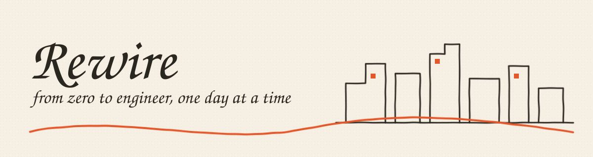
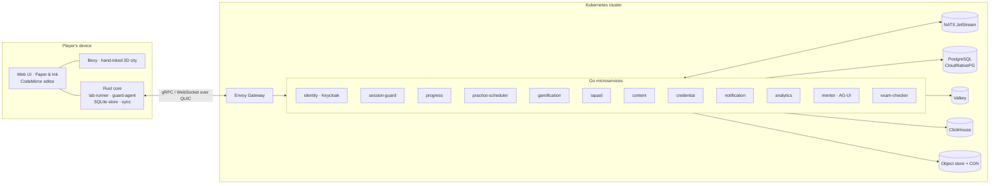

<p align="center">
  
</p>

<p align="center">
  <b>A free, open-source open-world game that turns complete beginners into real engineers, one short daily session at a time.</b>
</p>

<p align="center">
  <a href="LICENSE"></a>
  <a href="#project-status"></a>
  <a href="CONTRIBUTING.md"></a>
  <a href="CODE_OF_CONDUCT.md"></a>
</p>

---

## What is PlayRewire?

**PlayRewire** (shown in-game as **Rewire**) is a game you play for 15–20 minutes a day. You roam a hand-inked open-world city, take on missions, and team up with friends in squad heists. Along the way you learn **how computers really work**, from silicon and network cables up to kernels, databases and distributed systems, and you build **muscle memory** writing real code.

It's for people who:

- have **never written code** and feel scared of it,
- tried before and **bounced off syntax**,
- found **DSA** a wall they couldn't climb.

You don't watch lectures. You **see** an idea, **type** it, **drill** it until your fingers remember, then **use** it to change the world in front of you.

> We start with **Go**. The engine is built so any programming language can be added as a lesson pack.

## Why

Most learning platforms assume you already have the foundations, and most beginners quit within the first week. Rewire is built around three ideas:

1. **Foundations first, interleaved with code.** You learn what a CPU, a router and a kernel are *while* writing small Go programs from day one.
2. **Muscle memory beats memorization.** Short daily drills adapt to *your* mistakes, and yesterday's errors become today's warm-up.
3. **Play makes people come back.** Open world, story missions, squads, streaks and cosmetic rewards, with no guilt tactics and no pay-to-win.

## Features

| | |
|---|---|
| 🗺️ **Open-world city** | Ten districts, each one part of the curriculum. Unexplored areas are blank paper that gets inked in as you master them. |
| ✍️ **See → Type → Drill → Use** | Every concept is a small chunk taught in four steps, with help that fades as you improve. |
| 🧠 **Adaptive daily practice** | A spaced-repetition engine schedules drills from what *you* got wrong. |
| 👥 **Squad mode** | 2–4 friends, one heist, one timer. Each player codes a subsystem and can send hint pings. |
| 💻 **Local lab** | Code runs **on your device**: the real Go toolchain in a sandbox on desktop, a WASM Go interpreter on web and mobile. |
| 🛡️ **Guardrails** | One live session per user, activity detection, and a locked-down exam mode. |
| 🏅 **Verifiable certificates** | Open Badges 3.0 credentials you can add to **LinkedIn** and **Credly**. |
| 📈 **Personal analytics** | A hand-drawn skill map of what you've learned and what keeps breaking. |
| 🎨 **Paper & Ink design** | A unique hand-drawn look, accessible from day one. |
| 🤖 **AI mentor (bring your own model)** | Nudges instead of answers, streamed to the HUD over [AG-UI](https://docs.ag-ui.com). Works with local models (Ollama, llama.cpp, LM Studio) or NVIDIA NIM, OpenRouter, OpenAI, Anthropic, Meta, DeepSeek, MiniMax, any OpenAI-compatible endpoint, and an optional [OmniRoute](https://github.com/diegosouzapw/OmniRoute) preset for pooled free tiers. Runs from your device with your own keys. |
| 📦 **Every platform** | Linux (deb, rpm, AUR, Flatpak, AppImage), Windows, macOS, Android, iOS, Web. |

## The curriculum is the map

| # | District | You learn |
|---|---|---|
| 1 | **Silicon Quarter** | CPU, GPU architectures, motherboard and buses, RAM/ROM, storage, I/O |
| 2 | **The Wire** | Cables, Wi-Fi, switches, routers, IP, DNS, TCP/UDP, OSI layers, HTTP/TLS |
| 3 | **Terminal Alley** | Shell, files, processes, pipes, permissions |
| 4 | **Git Archive** | Commits, branches, merges, rebases, remotes, pull requests |
| 5 | **The Underground** | Processes, threads, scheduling, memory, syscalls, the kernel, **eBPF** |
| 6 | **Go Academy** | The Go language, from first program to generics and modules |
| 7 | **DSA Arena** | Complexity, core data structures, sorting, graphs, recursion, DP |
| 8 | **Data Vaults** | Database types, indexes, transactions, replication, sharding, CAP, **Raft** |
| 9 | **Architect's Tower** | Monolith vs microservices, caching, queues, Kubernetes, cloud native |
| 10 | **The Summit** | Advanced Go with advanced DSA: runtime, concurrency, profiling, production |

## Architecture

The core rule: **all code execution and rendering happen on the player's device. The cluster only stores progress, coordinates squads, and sends signals.** The one exception is a small, sandboxed `exam-checker` that verifies certification exams.



Built on cloud-native open source: Kubernetes, Keycloak, Envoy, NATS, CloudNativePG, OpenTelemetry, Prometheus, Grafana, Cilium, Argo CD, cert-manager, Kyverno and Helm.

📐 **Full design:** [docs/superpowers/specs/2026-10-21-playrewire-design.md](docs/superpowers/specs/2026-10-21-playrewire-design.md)

## Project status

**🟠 Design phase.** The design document is written and under review. No playable build exists yet.

See the [roadmap](ROADMAP.md) for the phases, from the first technical spikes to a first playable build, then online play, squads, certification and every platform.

## Getting started

### Play

Rewire runs on Linux for now, as a desktop app or in your browser.

- **Desktop:** download the `.deb`, `.rpm` or `.AppImage` from [Releases](https://github.com/iemafzalhassan/playrewire/releases). Check its signature first, then install it. Both steps are in [docs/install.md](docs/install.md).
- **Web:** host the `rewire-web-<ver>.tar.gz` build on any static web server. See [Self-host the web app](docs/install.md#self-host-the-web-app).

### Develop

You need Rust 1.99 with the `wasm32-unknown-unknown` target, Go 1.27.2, Node 26, pnpm 12, [just](https://github.com/casey/just) and `wasm-bindgen` 0.2.129. The desktop app also needs bubblewrap and the WebKitGTK 4.1 dev packages. On Ubuntu: `sudo apt install bubblewrap libwebkit2gtk-4.1-dev librsvg2-dev`.

```sh
pnpm install
just test          # Rust, Go and web tests
just dev-web       # web app at http://localhost:5173
just dev-desktop   # desktop app (needs: cargo install tauri-cli --version 2.12.3 --locked)
just bundle        # deb, rpm, AppImage and the web tarball, in target/release/bundle/
```

Packaging and the Linux sandbox are covered in [packaging/linux/README.md](packaging/linux/README.md).

## Contributing

PlayRewire is built in the open, and we especially want:

- **Engineers:** Rust (Bevy, Tauri), Go (services), TypeScript (UI), Kubernetes.
- **Educators and writers:** lesson chunks, missions, and plain-language explanations.
- **Artists:** ink-style 3D assets, characters, UI illustration.
- **Translators:** every lesson is data and can be localized.

Read [CONTRIBUTING.md](CONTRIBUTING.md) to get started. All commits require a [DCO](https://developercertificate.org/) sign-off.

## Community

- **Discussions:** [GitHub Discussions](https://github.com/iemafzalhassan/playrewire/discussions)
- **Issues:** [GitHub Issues](https://github.com/iemafzalhassan/playrewire/issues)
- **Security:** see [SECURITY.md](SECURITY.md). Please don't file public issues for vulnerabilities.

## Governance

PlayRewire is an independent, sole-owner open-source project led by [@iemafzalhassan](https://github.com/iemafzalhassan). See [GOVERNANCE.md](GOVERNANCE.md) and [MAINTAINERS.md](MAINTAINERS.md).

## License

- **Code:** [Apache License 2.0](LICENSE)
- **Lesson content:** [CC BY-SA 4.0](https://creativecommons.org/licenses/by-sa/4.0/)
- **Art assets:** CC0 or CC-BY, noted next to each asset

---

<p align="center"><i>Rewire: from zero to engineer, one day at a time.</i></p>
