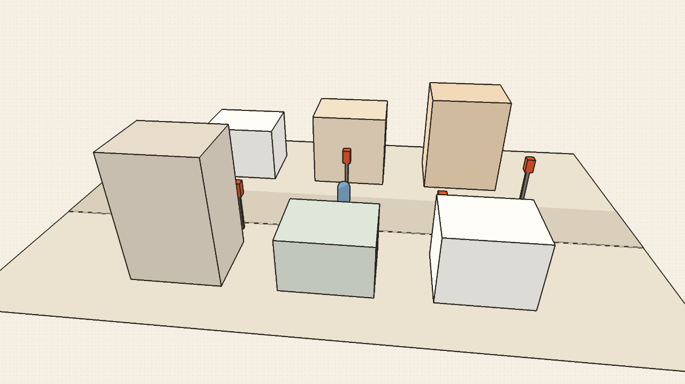
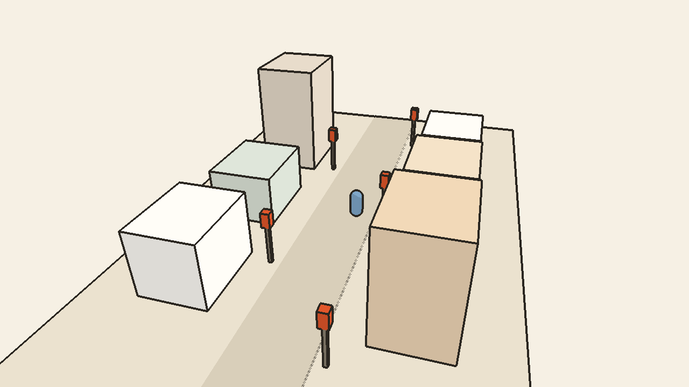

# Spike: Bevy WASM in the desktop webview, with an ink look

Date: 2026-10-21. Task 2 of the MVP plan. Verdict: **PASS**.

## Question

Can the 3D city run as Bevy compiled to WASM (WebGL2), drawn into a `<canvas>` with a
transparent background over CSS paper, at playable frame rates in the engine the Linux
desktop app uses (WebKitGTK), and at a download size we can ship?

## What was built

- `crates/rewire-world`: Bevy 0.20.0, `default-features = false`, only `std`,
  `async_executor`, `bevy_asset`, `bevy_log`, `bevy_window`, `bevy_winit`, `bevy_render`,
  `bevy_core_pipeline`, `bevy_pbr`, `bevy_mesh`, `bevy_shader`, `bevy_material`,
  `bevy_camera`, `bevy_color`, `webgl2` (plus `x11` on native targets so winit compiles).
  No audio, no gilrs/udev. `crate-type = ["cdylib", "rlib"]`.
- Scene: ground plane, a road strip, 6 box buildings, 5 traffic lights (post + lamp box),
  a capsule player, and a camera that orbits the street automatically. Window/canvas
  1280×720 with the scale factor forced to 1, so every browser renders the same number of
  pixels.
- Ink look (`src/ink.rs`, `src/ink.wgsl`): one fullscreen pass in
  `Core3dSystems::PostProcess`. Meshes use unlit materials, and the pass does
  1. **flat 2-band toon shading** from the normal prepass (world normal against a fixed
     light, dark band = 0.72×), and
  2. a **screen-space edge-detect outline** from depth and normal discontinuities
     (4 neighbours at 2 px; relative depth > 4 % or normal dot < 0.75), in ink `#2a2620`.
  Pixels with no geometry stay fully transparent, so the CSS paper (`#f6f0e4`) shows.
- `apps/web/spike/world.html`: paper background, transparent canvas, loads
  `public/world/rewire_world.js`. `just wasm` builds it (cargo + `wasm-bindgen --target web`).
- FPS: `FrameTimeDiagnosticsPlugin` is on; a system logs
  `rewire-world fps avg5s=<frames/real seconds over the last 5 s> diag=<plugin average>`
  every 5 s.

### WebGL2 notes (things that will matter in Task 16)

- **No `DepthPrepass` on WebGL2.** Bevy can't copy depth textures there
  (bevy issue #9710), so the depth half of the outline reads the **main view depth
  texture** directly: `Camera3d.depth_texture_usages |= TEXTURE_BINDING`, `Msaa::Off`,
  bound as an unfilterable `texture_2d<f32>`. Same approach as Bevy's motion blur.
  `NormalPrepass` works on WebGL2. So the planned depth + normal post-process works; the
  inverted-hull fallback was **not** needed.
- **Pair every texture with a sampler.** With `textureLoad` and no sampler in the bind
  group, WebGL2 read zeros (the pass ran but did nothing). Sampling with a nearest
  sampler (`textureSampleLevel`) fixed it.
- `Tonemapping::None` and `DebandDither::Disabled` keep the flat colours exact and the
  alpha intact. The WebGL context defaults (`alpha: true`, premultiplied) give a
  transparent canvas with `ClearColor(Color::NONE)`.
- Known look artifacts, fine for a spike: the 2 cm road strip gets a dotted edge line
  where depth is close to the threshold, and faces seen almost edge-on fill with ink.

## Measurement

Machine: Intel i5-8257U, Intel Iris Plus 645 (Mesa 26.2.5), Arch Linux, Hyprland,
2560×1600 panel at **60 Hz** with scale 2. Release wasm build.

- **Chromium**: Playwright 1.63.0 (cached Chromium build 1243), headed, viewport
  1280×720, DPR 1, `--ignore-gpu-blocklist`. WebGL renderer: `ANGLE (Intel, Mesa Intel(R)
  Iris(R) Plus Graphics 645 (CFL GT3), OpenGL ES 3.2)`. Script: `apps/web/spike/measure.mjs`.
- **WebKit**: WebKitGTK **2.54.1** MiniBrowser (`/usr/lib/webkit2gtk-4.1/MiniBrowser
  --full-screen`), the same engine as the Tauri webview on Linux (ruling R3; Playwright's
  WebKit doesn't run on Arch). The page mirrors each FPS log line to the spike server as
  `GET /__fps?...`, and the numbers are read from the server log. Script:
  `apps/web/spike/measure-webkit.sh` (server: `apps/web/spike/server.py`).
- Each run lasts 60 s after a dropped first window (startup + shader compile). That gives
  12 five-second windows per browser.

### Raw numbers (final build)

| Window (5 s) | 1 | 2 | 3 | 4 | 5 | 6 | 7 | 8 | 9 | 10 | 11 | 12 | mean | min |
|---|---|---|---|---|---|---|---|---|---|---|---|---|---|---|
| Chromium | 60.0 | 60.0 | 60.0 | 60.0 | 60.0 | 60.0 | 60.0 | 60.0 | 60.0 | 60.0 | 60.0 | 60.0 | **60.0** | 60.0 |
| WebKitGTK | 54.8 | 60.0 | 60.0 | 60.0 | 60.0 | 59.4 | 59.4 | 60.0 | 60.0 | 60.2 | 60.2 | 60.0 | **59.5** | 54.8 |

The dropped startup window was about 50 fps in both. An earlier run of the same scene
(before the size fix below, same code) gave Chromium mean 59.9 (min 59.7) and WebKitGTK
mean 59.4 (min 54.4). Both browsers are capped by the 60 Hz vsync, so these numbers show
there is headroom but not how much.

### Size

| Build | `rewire_world_bg.wasm` | gzip -9 |
|---|---|---|
| release, default | 70.3 MB | 10.1 MB |
| release + `strip = "symbols"` for rewire-world (committed) | 34.3 MB | **7.36 MB** |

The difference is the wasm `name` section (36 MB raw). Stripping it has no runtime effect.
`wasm-opt` isn't installed here. It would cut more and is an easy later win.

## Screenshots

Chromium (Playwright screenshot):

WebKitGTK MiniBrowser (captured inside the page: canvas drawn over the paper colour, then
POSTed to the spike server, because the desktop session was locked and `grim` only saw
the lock screen):

## Pass criteria

| Criterion | Target | Measured | Result |
|---|---|---|---|
| WebKit sustained fps | ≥ 30 | mean 59.5, worst 5 s window 54.8 | PASS |
| Chromium fps | ≥ 55 | mean 60.0, worst 60.0 | PASS |
| gzipped wasm | ≤ 15 MB | 7.36 MB | PASS |

**Verdict: PASS.** We keep the Bevy-in-webview path, and `crates/rewire-world` is the
starting point for Task 16.

## Caveats

- **The desktop session was locked (quickshell lock screen) during the runs.** Frames
  still rendered and were presented at 60 fps (the frame counter is real time, and the
  in-page WebKit capture shows a correct, moving frame), but the compositor wasn't showing
  the windows. An unlocked, visible run might differ slightly. Task 15 re-checks this.
- The in-Tauri check (`cargo tauri dev`) moves to **Task 15's manual check** (ruling R3).
  The Tauri shell doesn't exist yet. MiniBrowser uses the same WebKitGTK engine, but the
  Tauri webview could differ slightly.
- One GPU (Intel iGPU) and a 60 Hz display only. There is no headroom number above
  vsync, and no low-end or NVIDIA data.
- The scene is the spike scene (about 20 meshes). Task 16 adds more. The ink pass is a
  fixed per-pixel cost, so scene growth mostly affects the main pass.
